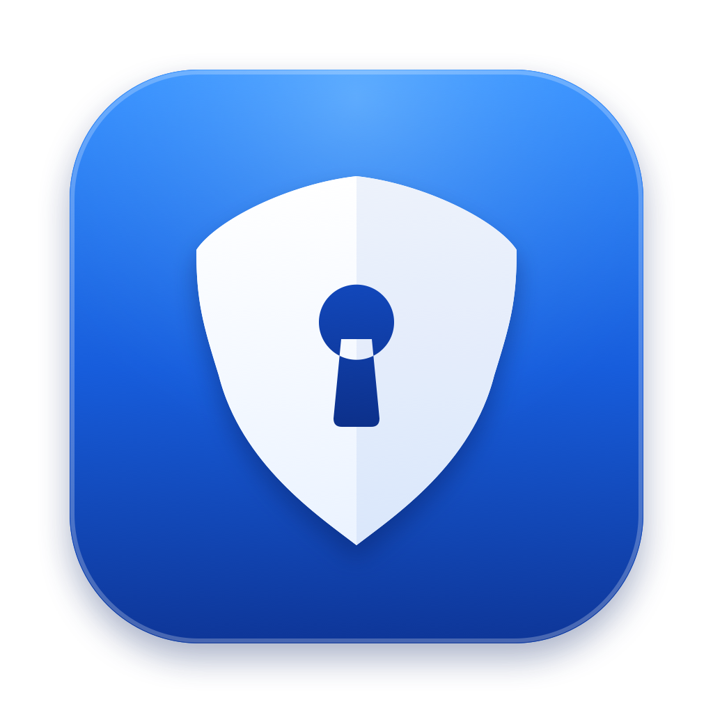

<p align="center">
  
</p>

<h1 align="center">GoVault</h1>

<p align="center">
  A small, fast, native desktop client for <a href="https://github.com/dani-garcia/vaultwarden">Vaultwarden</a> and Bitwarden-compatible servers.
</p>

<p align="center">
  <a href="https://github.com/txchen/govault/releases/latest"></a>
  <a href="go.mod"></a>
  
  
  <a href="LICENSE"></a>
</p>

<p align="center">Built with <a href="https://nsgo.dev">NSGo</a>.</p>

<p align="center">
  <picture>
    <source media="(prefers-color-scheme: dark)" srcset="docs/screenshots/vault-dark.png">
    
  </picture>
</p>

<p align="center"><sub>Follows the system appearance: <a href="docs/screenshots/vault-light.png">light</a> and <a href="docs/screenshots/vault-dark.png">dark</a>.</sub></p>

## Install

### macOS (Apple silicon)

With [Homebrew](https://brew.sh) (recommended):

```sh
brew install --cask txchen/tap/govault
```

Or download `govault-<version>-macos-arm64.dmg` from [Releases](https://github.com/txchen/govault/releases/latest). The app is signed with a Developer ID and notarized by Apple. It updates itself; you can also choose **GoVault → Check for Updates…** at any time, even before signing in.

### Linux (x86_64 and arm64)

```sh
curl -fsSL https://raw.githubusercontent.com/txchen/govault/master/scripts/install-linux.sh | sh
```

The script detects your distribution and installs:

- the `.pkg.tar.gz` package with `pacman` on Arch, Manjaro and EndeavourOS,
- the `.deb` package with `apt` on Debian, Ubuntu and derivatives,
- the `.AppImage` everywhere else (Fedora, openSUSE and others), with a launcher entry and icon.

Every download is checked against the release's `checksums.txt` before anything is installed. Options go after `sh -s --`:

| Option | Effect |
|---|---|
| `--version v0.2.5` | Install a specific release instead of the latest |
| `--appimage` | Use the AppImage on any distribution |
| `--system` | Install the AppImage for all users under `/usr/local` |
| `--uninstall` | Remove GoVault (your vault cache and settings are kept) |

For example: `curl -fsSL https://raw.githubusercontent.com/txchen/govault/master/scripts/install-linux.sh | sh -s -- --appimage`

GoVault needs GTK 4 on Linux; the AppImage also needs FUSE 2.

### Try it without a server, or build from source

You need Go (see [`go.mod`](go.mod) for the version).

```sh
git clone https://github.com/txchen/govault && cd govault
go run ./cmd/govault --demo        # built-in sample vault, separate settings, no server needed
CGO_ENABLED=0 go build ./cmd/govault
go tool nsgo build -target macos_arm64 ./cmd/govault   # app bundle and installers
```

## Why GoVault?

Bitwarden's mobile apps are native, but its desktop app is an Electron and Angular application: it ships a Chromium browser engine and Node.js, runs several processes, and is large to download and keep in memory. GoVault is a desktop client written in Go on native platform views (AppKit on macOS, GTK 4 on Linux), with no CGO and a single process.

| | GoVault 0.2.5 | Bitwarden Desktop 2026.10.4 |
|---|---|---|
| UI stack | Native views via [NSGo](https://nsgo.dev), Go, zero CGO | Electron (Chromium + Node.js) and Angular |
| macOS download | 6.6 MB DMG (Apple silicon) | 350.7 MB DMG (universal) |
| macOS app on disk | 21.5 MB | 1,033 MB (universal: x86_64 + arm64) |
| Linux download (x86_64) | 7.0 MB `.deb`, 8.0 MB AppImage | 163.7 MB `.deb`, 215.8 MB AppImage |
| Processes while idle | 1 | 4 (main, GPU, network, renderer) |
| Memory, idle with the vault unlocked | 64 MB | 464 MB in total |
| CPU, idle with the vault unlocked | under 0.1% | about 3% in total |

<sub>Measured on an Apple silicon Mac running macOS 27.2. Memory is the physical footprint from `footprint`, summed over all of an app's processes. CPU is from seven `top` samples 5 seconds apart and from the CPU time each app used over the same 30 seconds. Both apps were signed in to the same account and vault (about 440 items), showing the main vault list with no item open, idle for at least 30 seconds (CPU time used: GoVault 0.02 s, Bitwarden 0.96 s). Download sizes are the release assets on GitHub.</sub>

GoVault does not replace everything the official app does. It has no Windows or Intel Mac build, no Bitwarden Send, no passkey management and no browser-extension integration, and accounts are created on your server's web vault.

## Features

**Compatible with your server**

- Works with Vaultwarden and Bitwarden-compatible servers: PBKDF2 and Argon2id key derivation, AES-256-CBC with HMAC-SHA256 item encryption, per-item keys.
- Real-time sync over the server's SignalR (MessagePack) channel, so changes from other devices appear immediately.
- Offline first: the vault opens from an encrypted local cache when the server is unreachable.

**Sign-in and security**

- Two-step login with an authenticator app or email, with "remember this device".
- Touch ID unlock on macOS, using a hardware-protected keychain item when the build is entitled to it.
- Locks after inactivity and, on macOS, when the Mac sleeps or the screen locks.
- Master password reprompt for sensitive items: revealing, copying, editing and showing verification codes ask again.
- Copied secrets clear themselves from the clipboard. On macOS they are marked concealed and transient so clipboard managers skip them.
- Releases macOS Secure Event Input as soon as a password field no longer needs it.

**Your vault**

- Logins (with live verification codes), cards, identities, secure notes and **SSH keys**, with an Ed25519 key generator and an optional read-only local `ssh-agent` (off by default).
- **Attachments**: encrypted upload, download and delete. Downloads are written as private files.
- **Password history** for logins.
- **Organizations and shared collections**, honoring read-only and hidden-password permissions.
- **Vault Health**: reused and weak passwords, expiring cards and unsecured websites, checked entirely on your device.
- **Encrypted backup**: export a password-protected, Bitwarden-compatible JSON file.
- **Reviewed import**: import Bitwarden JSON exports and approve each change. Nothing in your vault is overwritten unless you choose to.
- Clone items, empty Trash, folders, favorites, password and passphrase generator.
- Website icons from your own server, with a switch to turn them off.

**Native desktop**

- Light and dark appearance, resizable three-pane layout.
- Search from the toolbar (⌘F), scoped to the selected category or folder with one click to search everything.
- Back and Forward through views and items, including the mouse side buttons on macOS.
- Optional menu bar icon, launch at login, keyboard shortcuts throughout.
- Signed automatic updates.

## Security

- **No plaintext on disk.** The vault is cached only as the server's encrypted data in an atomically written JSON snapshot, not in a database. The master password is never stored.
- **Keys leave memory on lock.** Locking or logging out wipes the user key, organization keys and decrypted items, and cancels pending network work and secret actions.
- **A UI-free core.** All cryptography, server communication and vault logic live in [`internal/vaultcore`](internal/vaultcore), which imports no GUI or platform code.

More detail:

- [Architecture and design](docs/architecture.md): system boundaries, security model and resource budget.
- [`vaultcore` specification](docs/vaultcore-spec.md): interfaces, Vaultwarden HTTP and SignalR contracts, encryption and test vectors.
- [UI and state machine](docs/ui-and-state-machine.md): screens, states, shortcuts and signal wiring.
- [Official client and protocol research](docs/research/official-client-and-protocol.md): the source analysis behind the design.

## License

GoVault is released under the [MIT License](LICENSE). Built with [NSGo](https://nsgo.dev) (Apache License 2.0).
