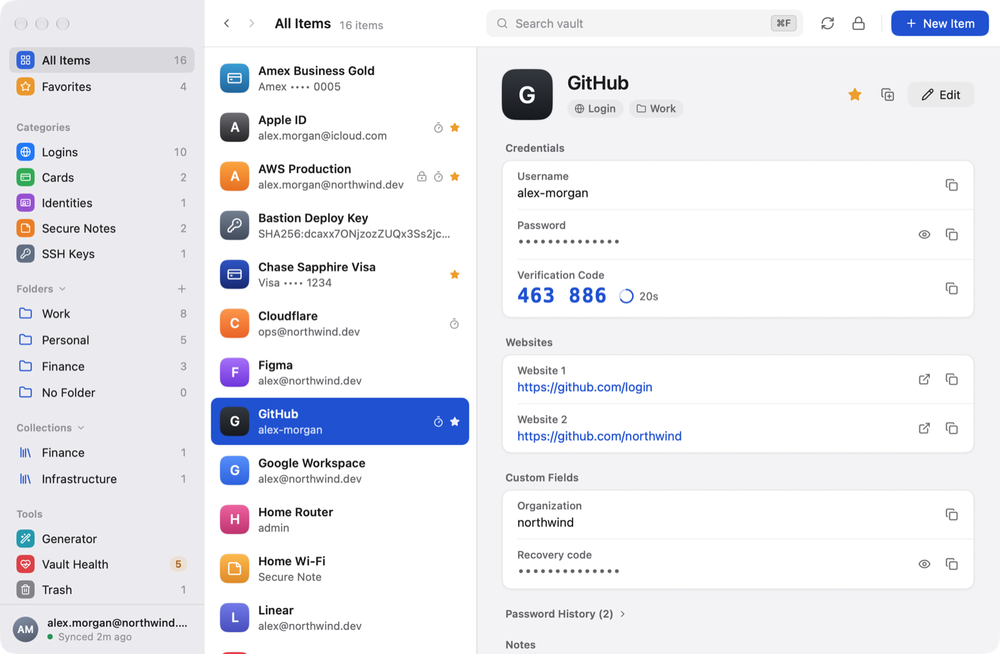

<p align="center">
  
</p>

<h1 align="center">GoVault</h1>

<p align="center">
  A small, fast, native desktop client for <a href="https://github.com/dani-garcia/vaultwarden">Vaultwarden</a> and Bitwarden-compatible servers.
</p>

<p align="center">
  <a href="https://github.com/txchen/govault/releases/latest"></a>
  <a href="go.mod"></a>
  
  
  <a href="LICENSE"></a>
</p>

<p align="center">Built with <a href="https://nsgo.dev">NSGo</a>.</p>

<p align="center">
  <picture>
    <source media="(prefers-color-scheme: dark)" srcset="docs/screenshots/vault-dark.png">
    
  </picture>
</p>

<p align="center"><sub>Follows the system appearance: <a href="docs/screenshots/vault-light.png">light</a> and <a href="docs/screenshots/vault-dark.png">dark</a>.</sub></p>

## Local Vaultwarden-only build

The `local/vaultwarden-only` branch is for a self-hosted Vaultwarden with TLS on port 443. Automatic and manual update checks are removed. The macOS bundle does not ship `gv` or Sparkle; the desktop client and its updates are built from source.

```sh
GOTELEMETRY=off go tool nsgo build -target macos_arm64 -installers=false \
  -id local.govault.desktop -ldflags '-X main.vaultOrigin=https://vault.example.com' ./cmd/govault
```

Replace the example origin on the build machine; do not commit it. For demo data, open the bundle with `--args --demo`.

For regular use, sign every build with the **same certificate and designated requirement** before installing. Ad-hoc builds change identity on every rebuild, so macOS may ask again for access to existing login Keychain entries. Use a dedicated local code-signing certificate, not a certificate belonging to another project or team. Keep the private key on the build Mac, outside the checkout in a directory accessible only to its owner.

For a local self-signed identity, use `rcodesign` and pin the leaf certificate in the requirement; no system-wide trust or notarization is needed. Set `bundle`, `certificate`, and `private_key` to your local paths:

```sh
fingerprint=$(openssl x509 -in "$certificate" -outform DER | shasum | cut -d ' ' -f1)
requirement="identifier \"local.govault.desktop\" and certificate leaf = H\"$fingerprint\""
reqdir=$(mktemp -d)
csreq -r "=$requirement" -b "$reqdir/govault.req" &&
  rcodesign sign --timestamp-url none --pem-file "$private_key" --pem-file "$certificate" \
    --code-requirements-file "$reqdir/govault.req" "$bundle" &&
  codesign --verify --deep --strict -R "=$requirement" "$bundle"
rm -r "$reqdir"
```

Keep the bundle ID and certificate unchanged for upgrades. Switching from ad-hoc to a certificate can still require granting the new build access to existing items once. Never broaden Keychain item access to all apps.

The desktop HTTP transport permits only that HTTPS origin, including for attachments, WebSocket sync, and site icons. Cross-origin redirects and environment proxies cannot forward these requests. External attachment links are not supported on this branch. Icon requests contain the site hostname; Vaultwarden may log it or look up a cache miss itself. This transport is not an OS firewall.

### Quick Access on macOS

While GoVault is running, focus the field you want to fill and press **Control–Shift–Space**. **GoVault → Quick Access** also opens the picker for search and copy. When the vault is locked, the shortcut opens the normal sign-in or unlock screen instead. Search for a login, select it with the arrow keys, and use the adjacent copy or fill buttons; Enter offers the available fill actions and Escape dismisses the panel.

Change, disable, or restore the shortcut under **Settings → Quick Access → Hot Key**. The registration status shows conflicts; the GoVault menu works even if no shortcut is registered.

Copy works without Accessibility. To enable fill, open **GoVault → Autofill Accessibility Settings…** and grant access to your installed GoVault app. The picker shows the captured app and window and rechecks focus before writing to that one field. A password requires a secure text field; other fields must be single-line text fields. Supported browser fields must expose their HTTPS origin, all containing frames must have that same origin, and the selected login must have an exact HTTPS origin match. Native targets require confirmation. GoVault never presses Tab or submits, and falls back to copy when the target cannot be verified. Items that require a reprompt still require verification. Quick Access uses the existing vault and adds no network requests or helpers.

The installation and CLI instructions below refer to upstream releases, not this branch.

## Install

### macOS (13 or later, Apple silicon and Intel)

With [Homebrew](https://brew.sh) (recommended):

```sh
brew install --cask txchen/tap/govault
```

Or download `govault-<version>-macos-arm64.dmg` (Apple silicon) or `govault-<version>-macos-x64.dmg` (Intel) from [Releases](https://github.com/txchen/govault/releases/latest). The app is signed with a Developer ID and notarized by Apple. It updates itself; you can also choose **GoVault → Check for Updates…** at any time, even before signing in.

### Linux (x86_64 and arm64)

```sh
curl -fsSL https://raw.githubusercontent.com/txchen/govault/v0.6.1/scripts/install-linux.sh | sh
```

The script detects your distribution and installs:

- the `.pkg.tar.gz` package with `pacman` on Arch, Manjaro and EndeavourOS,
- the `.deb` package with `apt` on Debian, Ubuntu and derivatives,
- the `.AppImage` everywhere else (Fedora, openSUSE and others), with a launcher entry and icon.

Before anything is installed, the script verifies the signature on the release's `checksums.txt` with `ssh-keygen` against the GoVault release key it pins ([`scripts/release-signing-key.pub`](scripts/release-signing-key.pub)), then checks the download against it. It needs OpenSSH 8.1 or later, and installs v0.3.0 and later releases, which are signed. Options go after `sh -s --`:

| Option | Effect |
|---|---|
| `--version v0.3.0` | Install a specific release instead of the latest |
| `--appimage` | Use the AppImage on any distribution |
| `--system` | Install the AppImage for all users under `/usr/local` |
| `--uninstall` | Remove GoVault (your vault cache and settings are kept) |

For example: `curl -fsSL https://raw.githubusercontent.com/txchen/govault/v0.6.1/scripts/install-linux.sh | sh -s -- --appimage`

GoVault needs GTK 4 on Linux; the AppImage also needs FUSE 2.

### Windows (x64 and arm64)

In PowerShell:

```powershell
irm https://github.com/txchen/govault/releases/latest/download/install.ps1 | iex
```

The script picks the installer for your processor, checks its SHA-256 and installs GoVault for your user account. You can also download `govault-<version>-windows-x64-setup.exe` (or `windows-arm64-setup.exe`) from [Releases](https://github.com/txchen/govault/releases/latest) and run it.

The installer is not code-signed yet, so Windows SmartScreen may show a warning the first time you run it: choose **More info**, then **Run anyway**. GoVault updates itself; you can also choose **Check for Updates…** from the tray icon or the GoVault menu (press Alt to show the menu bar).

### Try it without a server, or build from source

You need Go (see [`go.mod`](go.mod) for the version).

```sh
git clone https://github.com/txchen/govault && cd govault
go run ./cmd/govault --demo        # built-in sample vault, separate settings, no server needed
CGO_ENABLED=0 go build ./cmd/govault
go tool nsgo build -target macos_arm64 ./cmd/govault   # app bundle and installers
```

## Command line: `gv`

GoVault includes `gv`, a command-line client that speaks the [Bitwarden CLI](https://bitwarden.com/help/cli/)'s commands, options, environment variables and output, so scripts written for `bw` work by changing the command name. It needs no display or desktop session and runs on headless servers.

```sh
gv config server https://vault.example.com
gv login you@example.com              # or: BW_CLIENTID=… BW_CLIENTSECRET=… gv login --apikey
export BW_SESSION="$(gv unlock --raw)"  # unlock once per shell
gv list items --search github
gv get password github.com
gv get totp github.com
gv sync
gv lock
```

`gv` comes with GoVault; there is nothing else to download.

| Installed with | Putting `gv` on your PATH | Removing it |
|---|---|---|
| Windows installer | Automatic: the installer adds its folder to your user Path (open a new terminal) | Uninstalling GoVault removes `gv` and the Path entry |
| `install-linux.sh`, AppImage | Automatic: `~/.local/bin/gv` (`/usr/local/bin/gv` with `--system`), which keeps working without FUSE or a display and follows GoVault's updates | `install-linux.sh --uninstall` |
| `.deb` or pacman package | Automatic: `/usr/bin/gv` | Removing the package removes it |
| macOS app | **Settings → Command Line → Install** links `/usr/local/bin/gv` to the app (asks for an administrator password once) and updates with the app. It is offered for the signed GoVault in `/Applications` | **Settings → Command Line → Uninstall** |
| Homebrew | Automatic with the cask, from the first release whose app carries `gv` | `brew uninstall --cask govault` |

It supports `login` (master password with authenticator, email or YubiKey two-step login, or a personal API key), `unlock`, `lock`, `logout`, `status`, `sync`, `config server`, `list`, `get` (items, fields, TOTP codes, attachments, folders, collections, organizations, fingerprints), `create`, `edit`, `delete`, `restore` and `archive` (items, folders, attachments, item collections), `import` and `export` (Bitwarden JSON and CSV, encrypted with the account key or a password, and ZIP with attachments), `generate`, `encode` and `completion`. It does not yet move items to organizations, administer organizations, or use Send. `gv` keeps its own sign-in, separate from the app's, under `GoVault CLI` in your configuration directory (or `$BITWARDENCLI_APPDATA_DIR`), and keeps its credentials in the system keychain when there is one. See [docs/cli-design.md](docs/cli-design.md) for details and the few differences from `bw`.

## Why GoVault?

Bitwarden's mobile apps are native, but its desktop app is an Electron and Angular application: it ships a Chromium browser engine and Node.js, runs several processes, and is large to download and keep in memory. GoVault is a desktop client written in Go on native platform views (AppKit on macOS, GTK 4 on Linux, Win32 with Direct2D on Windows), with no CGO and a single process.

| | GoVault 0.2.5 | Bitwarden Desktop 2026.10.4 |
|---|---|---|
| UI stack | Native views via [NSGo](https://nsgo.dev), Go, zero CGO | Electron (Chromium + Node.js) and Angular |
| macOS download | 6.6 MB DMG (Apple silicon) | 350.7 MB DMG (universal) |
| macOS app on disk | 21.5 MB | 1,033 MB (universal: x86_64 + arm64) |
| Linux download (x86_64) | 7.0 MB `.deb`, 8.0 MB AppImage | 163.7 MB `.deb`, 215.8 MB AppImage |
| Processes while idle | 1 | 4 (main, GPU, network, renderer) |
| Memory, idle with the vault unlocked | 64 MB | 464 MB in total |
| CPU, idle with the vault unlocked | under 0.1% | about 3% in total |

<sub>Measured on an Apple silicon Mac running macOS 27.2. Memory is the physical footprint from `footprint`, summed over all of an app's processes. CPU is from seven `top` samples 5 seconds apart and from the CPU time each app used over the same 30 seconds. Both apps were signed in to the same account and vault (about 440 items), showing the main vault list with no item open, idle for at least 30 seconds (CPU time used: GoVault 0.02 s, Bitwarden 0.96 s). Download sizes are the release assets on GitHub.</sub>

GoVault does not replace everything the official app does. It has no Bitwarden Send and no browser-extension integration, and accounts are created on your server's web vault. GoVault keeps the passkeys stored in your vault, shows them on each item, and can remove them, but it cannot create passkeys or sign in with them. Use the Bitwarden browser extension for that.

On a free bitwarden.com account, GoVault shows the verification codes of your logins' TOTP secrets, in the app and with `gv get totp`, and runs Vault Health (reused and weak passwords, expiring cards, unsecured websites). The official apps include these with Premium; GoVault computes both locally on your device. Premium features that rely on Bitwarden's servers still need Premium: attachments, the Archive, YubiKey and Duo two-step login setup, emergency access, and file Sends.

## Features

**Compatible with your server**

- Works with Vaultwarden and Bitwarden-compatible servers: PBKDF2 and Argon2id key derivation, AES-256-CBC with HMAC-SHA256 item encryption, per-item keys.
- Real-time sync over the server's SignalR (MessagePack) channel, so changes from other devices appear immediately.
- Offline first: the vault opens from an encrypted local cache when the server is unreachable.

**Sign-in and security**

- Two-step login with an authenticator app or email, with "remember this device".
- Touch ID unlock on macOS, using a hardware-protected keychain item when the build is entitled to it.
- Locks after inactivity and, on macOS, when the Mac sleeps or the screen locks.
- Master password reprompt for sensitive items: revealing, copying, editing and showing verification codes ask again.
- Copied secrets clear themselves from the clipboard. On macOS they are marked concealed and transient so clipboard managers skip them.
- Releases macOS Secure Event Input as soon as a password field no longer needs it.

**Your vault**

- Logins (with live verification codes), cards, identities, secure notes and **SSH keys**, with an Ed25519 key generator and an optional read-only local `ssh-agent` (off by default).
- **Attachments**: encrypted upload, download and delete. Downloads are written as private files.
- **Password history** for logins.
- **Passkeys**: each login shows its passkey (website and creation date) read-only, and you can remove it. GoVault keeps passkeys and every other field it does not display intact when you edit an item.
- **Organizations and shared collections**, honoring read-only and hidden-password permissions.
- **Vault Health**: reused and weak passwords, expiring cards, unsecured websites and duplicate logins, checked entirely on your device.
- **Encrypted backup**: export a password-protected, Bitwarden-compatible JSON file.
- **Reviewed import**: import Bitwarden JSON exports and approve each change. Nothing in your vault is overwritten unless you choose to.
- Clone items, empty Trash, folders, favorites, password and passphrase generator.
- Website icons from your own server, with a switch to turn them off.

**Native desktop**

- Light and dark appearance, resizable three-pane layout.
- Search from the toolbar (⌘F), scoped to the selected category or folder with one click to search everything.
- Back and Forward through views and items, including the mouse side buttons on macOS.
- Optional menu bar icon, launch at login, keyboard shortcuts throughout.
- Speaks English, 简体中文, 繁體中文, 日本語, 한국어, Deutsch, Français, Español, Português (Brasil) and Русский, following your system language or the one you pick in Settings. Native speakers: please report translation problems in [GitHub issues](https://github.com/txchen/govault/issues) (see [docs/i18n.md](docs/i18n.md)).
- Signed automatic updates.

## Security

- **No plaintext on disk.** The vault is cached only as the server's encrypted data in an atomically written JSON snapshot, not in a database. The master password is never stored.
- **Keys leave memory on lock.** Locking or logging out wipes the user key, organization keys and decrypted items, and cancels pending network work and secret actions.
- **A UI-free core.** All cryptography, server communication and vault logic live in [`internal/vaultcore`](internal/vaultcore), which imports no GUI or platform code.

More detail:

- [Architecture and design](docs/architecture.md): system boundaries, security model and resource budget.
- [`vaultcore` specification](docs/vaultcore-spec.md): interfaces, Vaultwarden HTTP and SignalR contracts, encryption and test vectors.
- [UI and state machine](docs/ui-and-state-machine.md): screens, states, shortcuts and signal wiring.
- [Official client and protocol research](docs/research/official-client-and-protocol.md): the source analysis behind the design.

## License

GoVault is released under the [MIT License](LICENSE). Built with [NSGo](https://nsgo.dev) (Apache License 2.0). Passphrases use the [EFF large wordlist](https://www.eff.org/dice) by the Electronic Frontier Foundation, licensed under [CC BY 3.0](https://creativecommons.org/licenses/by/3.0/) (dice numbers removed).
